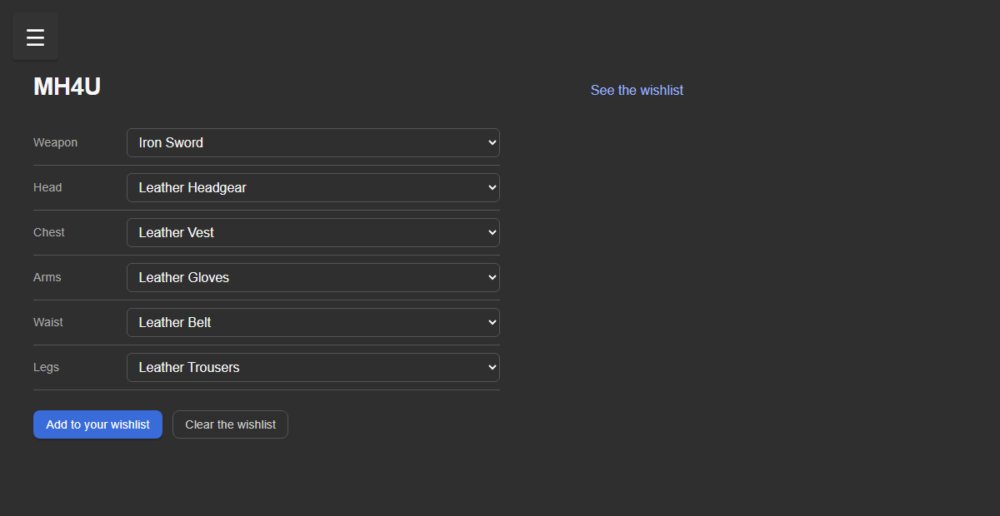

# MhWishlister

A desktop app for tracking Monster Hunter armor sets and the materials needed to craft them. Built with Tauri 2 and Vue 3, it currently supports **Monster Hunter 4 Ultimate (MH4U)** and **Monster Hunter Generations Ultimate (MHGU)**.



## Features

- Build a set from a weapon and five armor slots.
- Save multiple sets to a wishlist per game.
- See every material required by the selected set.
- Track how many materials you already own and how many are still missing.
- Dashboard with per-game progress and the materials that need farming the most.
- Delete individual sets from the wishlist.
- Light and dark mode.

## Tech stack

| Layer      | Technology                                      |
| ---------- | ----------------------------------------------- |
| Desktop    | Tauri 2, Rust                                   |
| Frontend   | Vue 3 (`<script setup>`), Vue Router 4          |
| Build tool | Vite 6                                          |
| Tests      | Vitest, Vue Test Utils, happy-dom               |

## Requirements

- [Node.js](https://nodejs.org/) 18 or newer
- [Rust](https://www.rust-lang.org/tools/install) (stable toolchain)
- The [Tauri system prerequisites](https://tauri.app/start/prerequisites/) for your OS
  - Windows: Microsoft C++ Build Tools and WebView2
  - macOS: Xcode Command Line Tools
  - Linux: `webkit2gtk`, `libappindicator`, and related packages

## Getting started

```bash
npm install
npm run tauri dev
```

The first Rust build can take a few minutes.

To work on the UI only:

```bash
npm run dev
```

This starts Vite without the Tauri runtime. The pages render, but Tauri commands are unavailable, so wishlist data will not load.

## Available scripts

| Command             | Description                                      |
| ------------------- | ------------------------------------------------ |
| `npm run dev`       | Start the Vite dev server                        |
| `npm run build`     | Build the frontend for production                |
| `npm run preview`   | Preview the production frontend                  |
| `npm test`          | Run the Vitest test suite                        |
| `npm run tauri dev` | Run the full desktop app in development          |
| `npm run tauri build` | Build the desktop application and installers   |

## Project structure

```text
Wishlister/
├─ docs/                      Screenshots
├─ src/
│  ├─ assets/                 Game data and owned-material files
│  ├─ components/             Saved wishlist JSON files
│  ├─ router/                 Vue Router configuration
│  ├─ utils/
│  │  ├─ games.js             Shared game configuration
│  │  └─ gameData.js          Set, material, and farm-summary helpers
│  └─ views/
│     ├─ Home.vue             Dashboard
│     ├─ Mh4uSelection.vue    MH4U set builder
│     ├─ MhguSelection.vue    MHGU set builder
│     ├─ Wishes.vue           Wishlist and material tracking
│     └─ About.vue            About and legal notice
├─ src-tauri/
│  ├─ src/lib.rs              Tauri commands and JSON persistence
│  └─ tauri.conf.json         Tauri configuration
├─ LICENSE
└─ package.json
```

## How it works

A saved set is a flat object of 1-based IDs:

```json
{
  "weapon": 1,
  "head": 1,
  "chest": 1,
  "arms": 1,
  "waist": 1,
  "legs": 1
}
```

The IDs are positions in the game data arrays in `src/assets/`. The frontend resolves names and materials from those files.

The dashboard aggregates requirements across all saved sets for a game, then subtracts owned materials once. This avoids counting the same stock multiple times when several sets need the same material.

### Tauri commands

| Command | Description |
| --- | --- |
| `load_wishlist(game)` | Read the saved sets for a game |
| `add_to_wishlist(game, selection)` | Append a set to the wishlist |
| `remove_from_wishlist(game, index)` | Delete one set by its position |
| `clear_wishlist(game)` | Empty the wishlist for a game |
| `load_owned_materials(game)` | Read the owned material counts |
| `save_owned_materials(game, owned)` | Persist the owned material counts |

The commands are implemented in `src-tauri/src/lib.rs` and called from the frontend with `invoke()`.

## Data storage

The app currently stores its data as JSON inside the source tree:

- `src/components/wishlistMh4u.json`
- `src/components/wishlistMhgu.json`
- `src/assets/materiaux_collectes_4u.json`
- `src/assets/materiaux_collectes_gu.json`

This is convenient during development, but it is not suitable for a packaged application: the paths are resolved from the Rust source directory. For distribution, these files should be moved to the Tauri app data directory.

## Tests

```bash
npm test
```

Rust tests:

```bash
cargo test --manifest-path src-tauri/Cargo.toml
```

## Disclaimer

MhWishlister is not affiliated with or endorsed by Capcom. Monster Hunter is a trademark of its respective owners.

## License

Released under the [MIT License](LICENSE).

## Author

Made by [Noicoco](https://github.com/noicoco).

## Contributors

- [Noicoco](https://github.com/noicoco) — game data, application design, and development.
- DeepSeek V4.1 Flash Free via [OpenCode](https://opencode.ai) — UI polish, tests, and documentation.
